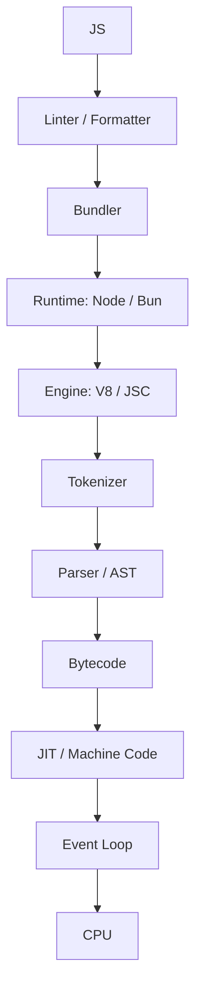

> JavaScript runs your code through a chain of layers, ending with a CPU instruction. You type one line and multiple layers process it. This post describes the steps in between.

Most developers do not know how their code runs, only that it runs. They run `npm run dev`, a port opens, and they return to other work. This post explains the layers that run their code each time.

Here is the code that the post follows through each layer:

```js
async function getUser() {
  const res = await fetch('https://api.example.com/user/1')
  const data = await res.json()
  console.log(data.name)
}

getUser()
```

The next sections show what each layer does to this code.

## Editor and Linter

Before the engine reads the code, a linter reads it. You can use [ESLint](https://eslint.org/), [Biome](https://biomejs.dev/), or [OXC](https://oxc.rs/). The linter checks the code before the engine runs it, without running it. It checks the source for problems, finding for example a `console.log` left in production code.

The linter uses the same [AST](https://en.wikipedia.org/wiki/Abstract_syntax_tree) that the engine produces later. It reads the AST first, before the engine compiles the code. Its output is not code, but annotations and warnings.

The **formatter** follows the linter, using [Prettier](https://prettier.io/), Biome, or the OXC formatter. The formatter does not check what your code means. It checks consistent indentation and lines under 300 characters, keeping the structure sound and presentable.

Neither tool runs your code. They work in the pre-execution layer, before the code runs.

## Bundler

You write `getUser` in one file, the calling UI in a second file, and utilities, types, and libraries in other files. In development these files stay separate, but a browser needs a single address for the code.

The **bundler** combines these files into deliverable artifacts, using [Vite](https://vite.dev/), [Rolldown](https://rolldown.rs/), [Turbopack](https://turborepo.dev/), [esbuild](https://esbuild.github.io/), or [webpack](https://webpack.js.org/). The bundler traces the import graph, where `getUser` imports `fetch` and each import points further. It follows each import to its origin.

```text
src/
  index.ts      ← imports getUser
  api/
    user.ts     ← defines getUser, imports fetch-wrapper
  utils/
    http.ts     ← defines fetch-wrapper
node_modules/
  some-lib/     ← also imported

         ↓  bundler traces every import  ↓

dist/
  bundle.js     ← one file, everything resolved
```

Modern bundlers do three more tasks in this phase. **Tree-shaking** removes imported code that never runs. **Code splitting** produces multiple bundles that load on demand. **Transpilation** converts TypeScript or modern JavaScript for wider environments.

Vite skips bundling in development, serving individual files over native ES modules using browser resolution, and bundles only for production. **Rolldown** is the Vite bundler, using Rust and OXC for speed. Older Vite versions use **Rollup**. **Turbopack** is the Rust successor to webpack, running in Next.js with the same minimal-work approach.

The bundler output is one JavaScript file, or a small set of files ready for a runtime.

## Runtime

Your bundled `bundle.js` now needs a runtime, such as **Node.js** or **Bun** on a server, or Chrome, Firefox, or Safari in a browser. The distinction matters.

Node.js is a thin shell around **V8** plus **libuv**, a C library providing the event loop, thread pool, and OS bindings missing from JavaScript. When you call `fetch` in Node 18 and later, V8 does not make the network request, having no network function. The Node undici HTTP client makes the request, written in JavaScript and C++. It exposes a Web-compatible `fetch` global that your code calls directly.

**Bun** is a newer runtime using **JavaScriptCore**, the Apple engine behind Safari and all iOS runtimes. Developers write Bun in Zig for speed, reimplementing Node APIs from scratch. The same `fetch` and `async/await` syntax works, but with a different engine, event loop, and tradeoffs.

The runtime provides the environment and the engine runs the code. You cannot have one without the other.

## Engine

The next step is the engine. V8 powers Node, Chrome, and Deno, while JavaScriptCore powers Bun and Safari. The implementations differ but share one contract, taking JavaScript source and running it.

### Tokenizer

The engine reads the source character by character, cutting it into **tokens**. A token is the smallest unit of meaning in the language.

```text
KEYWORD(async)  KEYWORD(function)  IDENT(getUser)  PUNCT(()  PUNCT())
PUNCT({)  KEYWORD(const)  IDENT(res)  PUNCT(=)  KEYWORD(await)
IDENT(fetch)  PUNCT(()  STRING("https://api.example.com/user/1")  PUNCT())
...
```

The tokenizer does not know that `fetch` is a function or that `await` stops the function. It only knows that these sequences have meaning for the grammar, then passes the tokens on.

### Parser and AST

A token list is not a program. The **parser** folds tokens into an **Abstract Syntax Tree**, a nested structure showing what tokens are and how they relate.

```json
{
  "type": "FunctionDeclaration",
  "async": true,
  "id": { "name": "getUser" },
  "body": [
    {
      "type": "VariableDeclaration",
      "kind": "const",
      "declarations": [
        {
          "id": { "name": "res" },
          "init": {
            "type": "AwaitExpression",
            "argument": {
              "type": "CallExpression",
              "callee": { "name": "fetch" },
              "arguments": [{ "value": "https://api.example.com/user/1" }]
            }
          }
        }
      ]
    }
  ]
}
```

The AST shows `fetch(...)` inside an `AwaitExpression`, inside a `VariableDeclaration`, inside an `async FunctionDeclaration`. The relation between parts matters.

### Bytecode

A CPU cannot run the AST directly, so the engine translates it into **bytecode**. Bytecode is a compact, portable instruction set, run by the V8 **Ignition** interpreter or the equivalent JSC **LLInt** interpreter.

```text
CreateClosure [getUser]
CallUndefinedReceiver [getUser]
SuspendGenerator        // first `await` pause here
CallRuntime [fetch, "https://api.example.com/user/1"]
ResumeGenerator         // fetch resolved continue
StoreAccumulatorInRegister [res]
...
```

The interpreter does not explain each instruction, running them one at a time. Bytecode stays readable, but it is not machine code yet.

### JIT Compilation

If the program calls `getUser` once, Ignition interprets the bytecode line by line, which is sufficient but not fast. Both V8 and JSC observe and measure the code, finding hot paths that run many times. They send hot paths to an optimizing compiler.

V8 uses **TurboFan** plus **Maglev** as a mid-tier compiler, while JSC uses **DFG** and **FTL**. All output raw **machine code**, binary instructions that the CPU runs directly without interpretation.

```asm
mov rdi, [fetch_ptr]
mov rsi, url_string_addr
call [rdi]
test rax, rax
jz   handle_rejection
...
```

The CPU has no concept of `async`, `fetch`, or JavaScript, knowing only registers, memory addresses, and jumps. Each upper layer is an abstraction from the CPU view.

## Event Loop

JavaScript is single-threaded, with one worker and one call stack. It handles network requests without freezing, using the event loop.

When execution reaches `await fetch(...)`:

```text
// Moment of the await:
Call Stack: [ getUser, (anonymous) ]

// getUser() hits `await`. It stops and leaves the stack.
// The Promise moves to the Node networking layer.
// That layer works outside the JS thread, in the libuv thread pool.

Call Stack: [ (anonymous) ]  ← nearly empty. The worker is FREE.

// ...time passes. The network responds. The Promise resolves.
// The resolved value enters the Microtask Queue.
// The Event Loop checks: is the call stack empty? Yes.
// getUser() continues, with res set to the Response object.

Call Stack: [ getUser, (anonymous) ]  ← resumed, mid-function.
```

The **Event Loop** manages the queues, so the call stack never waits for the network. The request runs separately, and the loop queues the result when ready. It gives the result to the worker as soon as the worker is free.

`await` is not sleep. It stops a function and returns control, continuing when data arrives. No work stops and other work continues. That is why Node serves thousands of concurrent requests on one thread, not by running in parallel but by never waiting.

## Complete Process



Each layer does exactly one job, unaware of the layers above it. The linter does not bundle, the bundler does not optimize, the JIT does not manage async, and the CPU does not parse.

You typed `getUser()`. Eleven layers ran it, mostly without your knowledge.
