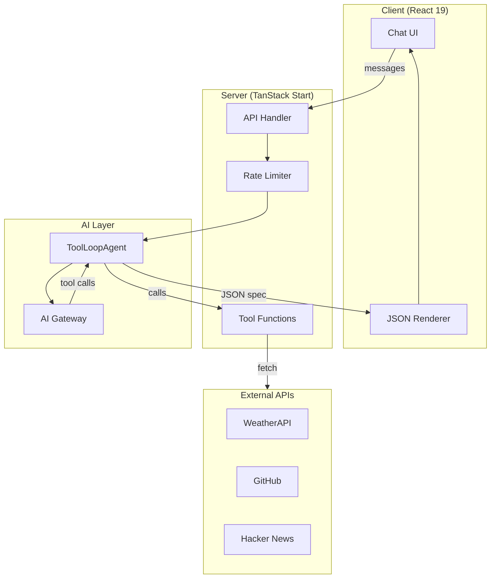

## Overview

Kite is an AI-powered data exploration assistant for weather, crypto prices, GitHub repositories, and news. It fetches real-time data and builds interactive dashboards, rendering entirely from JSON UI specifications. Kite serves as a reference implementation of the AG-UI protocol.

## Approach

Kite separates concerns across four layers:

- **Client**: React 19 UI with streaming chat, rendering AI responses as JSON-defined components with `@json-render/react`
- **Server**: TanStack Start server functions handle requests and rate limiting, forwarding traffic to the AI layer
- **AI**: ToolLoopAgent manages tool calls, formatting responses as text and JSON UI specs
- **Tools**: Server-side functions fetch real data from external APIs, covering weather, GitHub, crypto, and web search

## How it works

1. A message about a topic such as weather, crypto, or GitHub starts the flow.
2. The agent calls tools to fetch up-to-date data from external APIs.
3. The agent responds with a summary and a JSON UI specification.
4. The UI renderer renders the JSON spec as interactive React components.
5. The dashboard shows charts, tables, metrics, and rich content.

The UI is defined entirely in JSON, and `@json-render/react` renders it from the component tree the AI outputs.

## Tech stack

<TechStack>
  <TechStackItem label="TanStack Start">
    <Tanstack className="tech-stack-icon-needs-invert" />
  </TechStackItem>
  <TechStackItem label="React 19">
    <ReactLight />
  </TechStackItem>
  <TechStackItem label="shadcn/ui">
    <ShadcnUi className="tech-stack-icon-needs-invert" />
  </TechStackItem>
  <TechStackItem label="Tailwind CSS 4">
    <Tailwindcss />
  </TechStackItem>
  <TechStackItem label="Upstash Redis">
    <Upstash />
  </TechStackItem>
  <TechStackItem label="Netlify">
    <Netlify />
  </TechStackItem>
  <TechStackItem label="AI SDK">
    <Vercel className="tech-stack-icon-theme-light" />
    <VercelDark className="tech-stack-icon-theme-dark" />
  </TechStackItem>
</TechStack>
