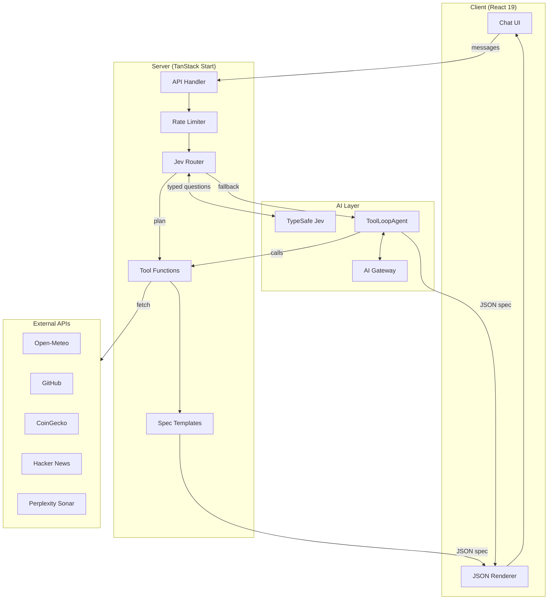

## Overview

Kite is an AI-powered data exploration assistant for weather, crypto prices, GitHub repositories, and news. It fetches real-time data and builds interactive dashboards, rendering entirely from JSON UI specifications. Kite serves as a reference implementation of the AG-UI protocol.

## Approach

Kite separates concerns across four layers:

- **Client**: React 19 UI with streaming chat, rendering responses as JSON-defined components with `@json-render/react`
- **Server**: A TanStack Start API route handles rate limiting, then tries the Jev router before handing off to the LLM agent
- **Jev router**: One TypeSafe Jev request answers which data sources the user wants and which arguments they mean. Code fetches the data and builds the dashboard from fixed templates, with no LLM involved
- **Agent**: A ToolLoopAgent behind the AI Gateway handles everything the router doesn't cover, calls tools, and writes the JSON UI spec itself

The router and the agent share the same server-side tools, which fetch real data from Open-Meteo, GitHub, CoinGecko, Hacker News, and Perplexity Sonar.

## How it works

1. A message about a topic such as weather, crypto, or GitHub starts the flow.
2. The Jev router reads it first, asking yes/no and multiple-choice questions about the message and about the cities, coins, repos, and counts that code pulls out of the text.
3. When the answers are clear, the router fetches the data and returns a templated dashboard straight away.
4. Otherwise the request falls back to the LLM agent. This covers other topics, explanations, quizzes, 3D scenes, uncertain answers, and any TypeSafe error. The agent calls tools and streams a summary plus a JSON UI spec.
5. The UI renderer turns the spec into interactive React components.

The UI is defined entirely in JSON, and `@json-render/react` renders it from the component tree. Components support data binding with `{ "$state": "/path" }`: fetched data goes into state, and components bind to it.

## Tools and components

| Tool | Data source | Jev router |
| --- | --- | --- |
| `getWeather` | Open-Meteo | Yes |
| `getGitHubRepo` | GitHub API | Yes |
| `getGitHubPullRequests` | GitHub API | Yes |
| `getCryptoPrice` | CoinGecko | Yes |
| `getCryptoPriceHistory` | CoinGecko | Yes |
| `getHackerNewsTop` | Hacker News API | Yes |
| `webSearch` | Perplexity Sonar (AI Gateway) | Agent only |

The agent can generate these component groups from JSON specs:

- **Layout**: Stack, Grid, Card, Tabs, TabContent, Accordion, Separator
- **Content**: Heading, Text, Badge, Callout, Alert, Link, Timeline, Progress, Skeleton
- **Data**: Metric, Table, BarChart, LineChart, PieChart
- **Input**: Button, RadioGroup, SelectInput, TextInput
- **3D**: Scene3D, Group3D, Box, Sphere, Cylinder, Cone, Torus, Plane, Ring, lights, Stars, Label3D

## Tech stack

<TechStack>
  <TechStackItem label="TanStack Start">
    <Tanstack className="tech-stack-icon-needs-invert" />
  </TechStackItem>
  <TechStackItem label="React 19">
    <ReactLight />
  </TechStackItem>
  <TechStackItem label="shadcn/ui">
    <ShadcnUi className="tech-stack-icon-needs-invert" />
  </TechStackItem>
  <TechStackItem label="Tailwind CSS 4">
    <Tailwindcss />
  </TechStackItem>
  <TechStackItem label="Upstash Redis">
    <Upstash />
  </TechStackItem>
  <TechStackItem label="Netlify">
    <Netlify />
  </TechStackItem>
  <TechStackItem label="AI SDK">
    <Vercel className="tech-stack-icon-theme-light" />
    <VercelDark className="tech-stack-icon-theme-dark" />
  </TechStackItem>
</TechStack>
